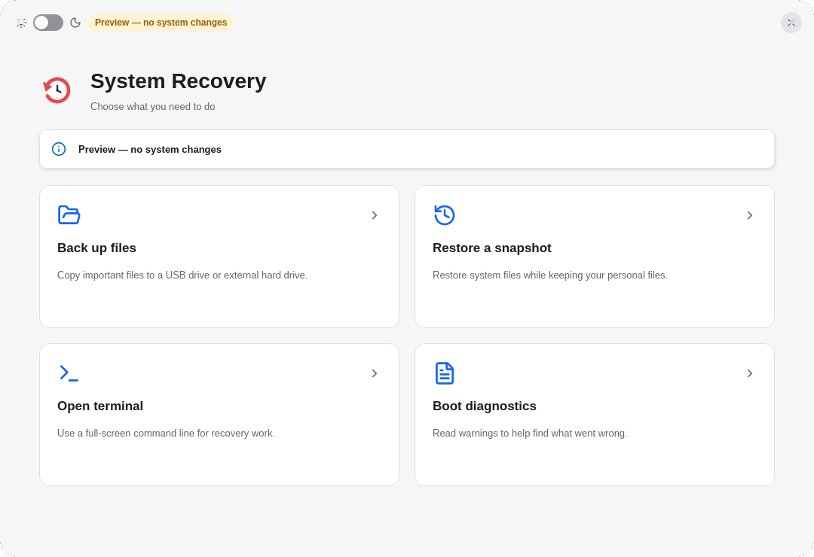
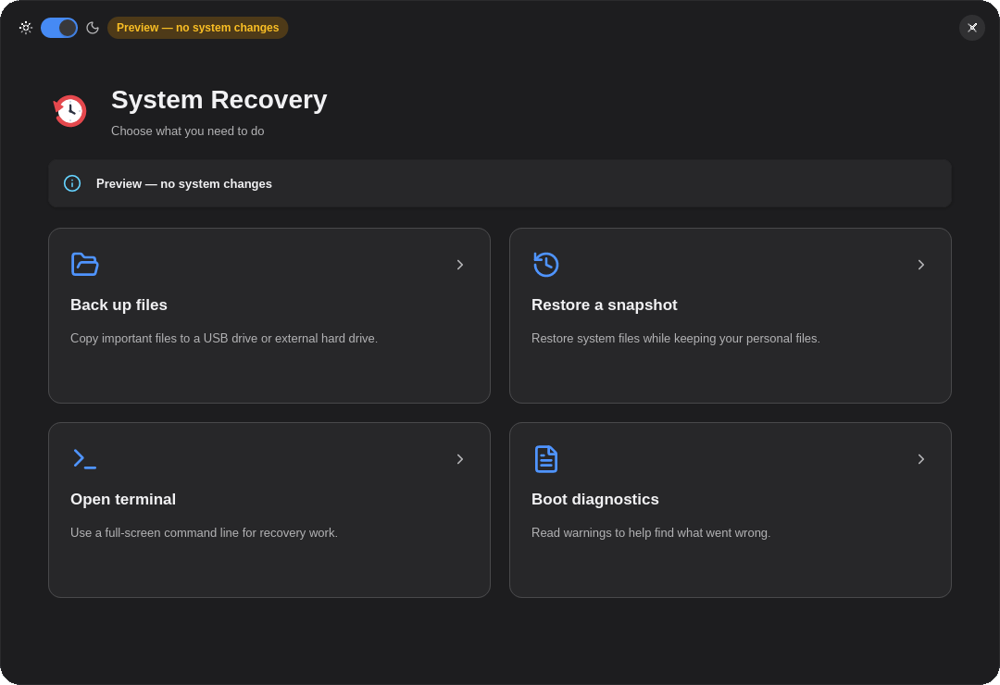
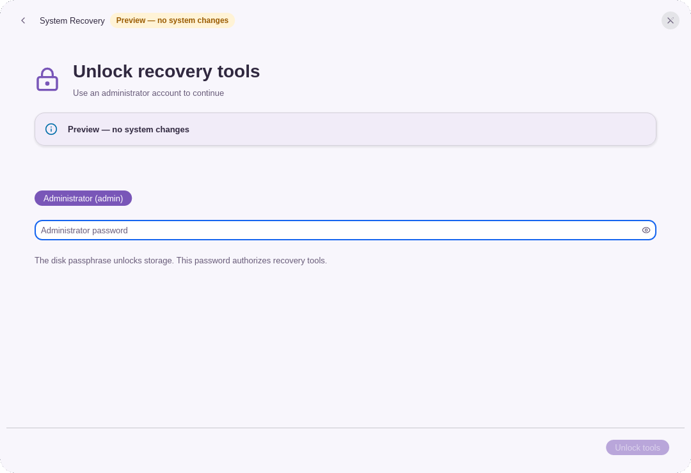
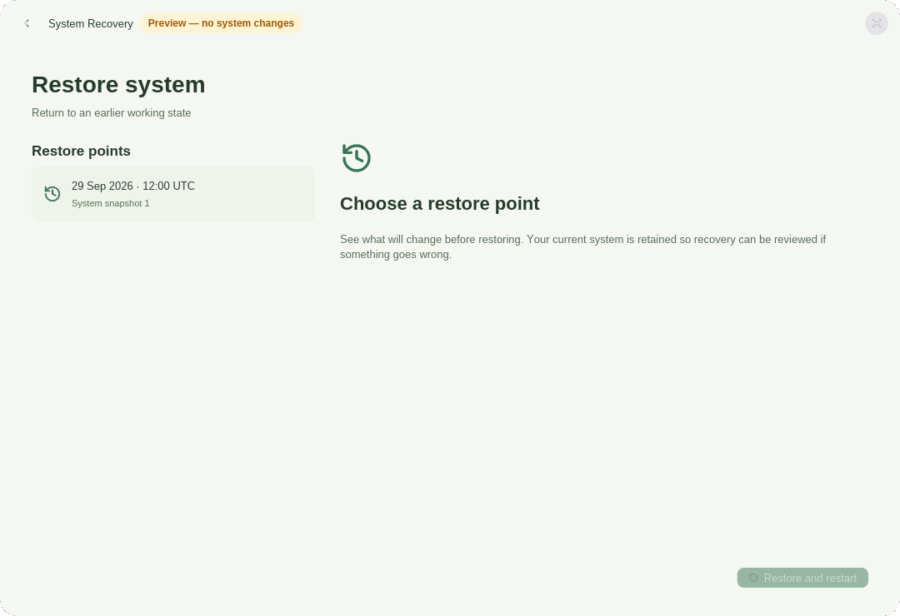
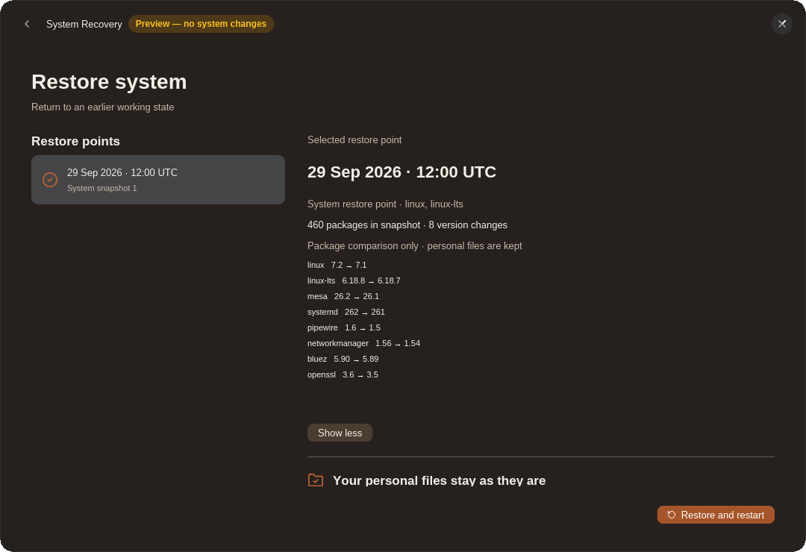
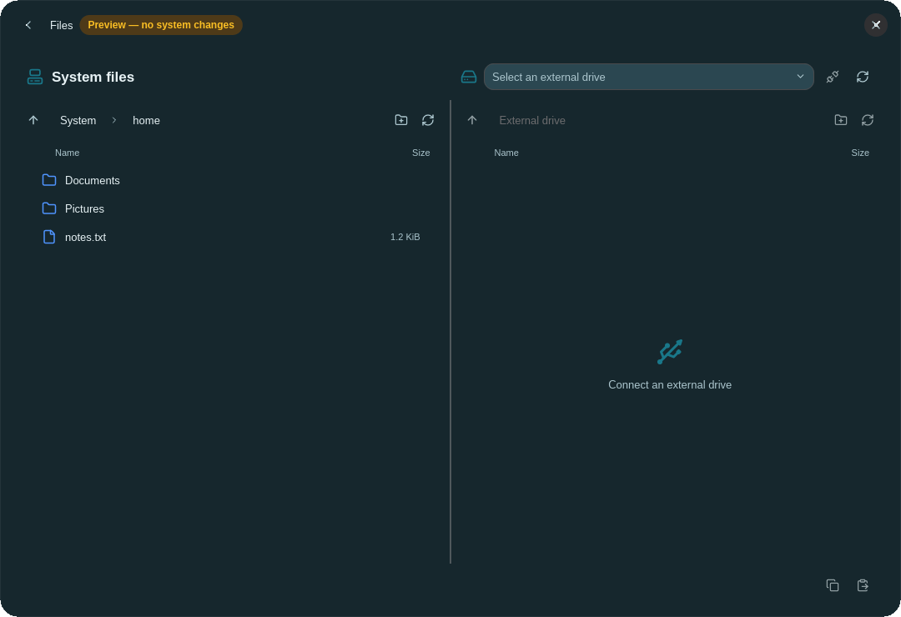
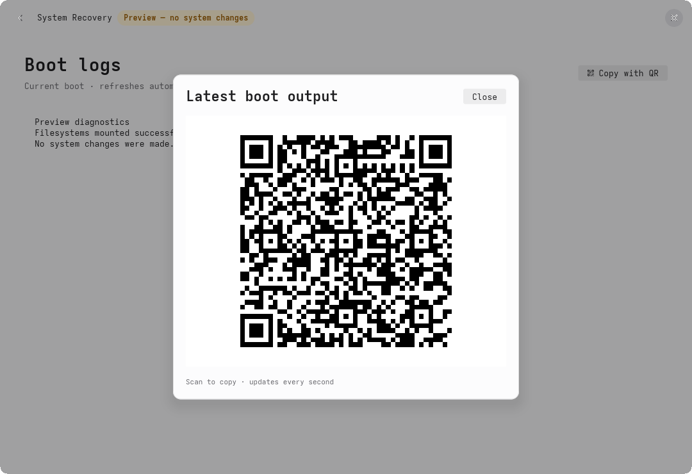
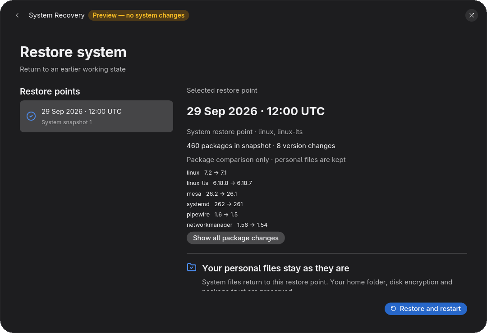

# enzimOS Recovery

Recovery lets you copy files to an external drive, review system snapshots and
inspect boot diagnostics. It also provides access to a recovery terminal. In the
recovery environment it can restore files from an encrypted backup.

<table>
  <tr>
    <td align="center"><a href="docs/screenshots/basic-light.png"></a><br><sub>Overview · light</sub></td>
    <td align="center"><a href="docs/screenshots/basic-dark.png"></a><br><sub>Overview · dark</sub></td>
    <td align="center"><a href="docs/screenshots/lavender.png"></a><br><sub>Authentication</sub></td>
    <td align="center"><a href="docs/screenshots/sage.png"></a><br><sub>Restore points</sub></td>
  </tr>
  <tr>
    <td align="center"><a href="docs/screenshots/ember.png"></a><br><sub>Package changes</sub></td>
    <td align="center"><a href="docs/screenshots/lagoon.png"></a><br><sub>File backup</sub></td>
    <td align="center"><a href="docs/screenshots/precision.png"></a><br><sub>Diagnostics QR code</sub></td>
    <td align="center"><a href="docs/screenshots/comfort.png"></a><br><sub>Snapshot details</sub></td>
  </tr>
</table>

## Build and preview

The repository selects Rust 1.99.1 and supports Rust 1.95 or newer. Build on
Linux with a C/C++ toolchain,
pkg-config, Wayland, XKB, GLib/GIO, fontconfig and graphics development libraries.
Cargo uses the public enzUI and foundation commits pinned in the lockfile.

```sh
cargo run --locked -- --demo
```

Demo mode uses sample files, snapshots and diagnostics. It never launches the
native recovery helpers or changes disks. The installed app uses the helper
package supplied by the enzimOS recovery environment.

## Development

```sh
cargo fmt --all -- --check
cargo test --locked --workspace --all-targets
cargo clippy --locked --workspace --all-targets -- -D warnings
```

Shared desktop themes apply through enzUI. Translations live in
[`assets/locales/`](assets/locales/). See [CONTRIBUTING.md](CONTRIBUTING.md) for
native workflow checks.

## License

[MIT](LICENSE)
